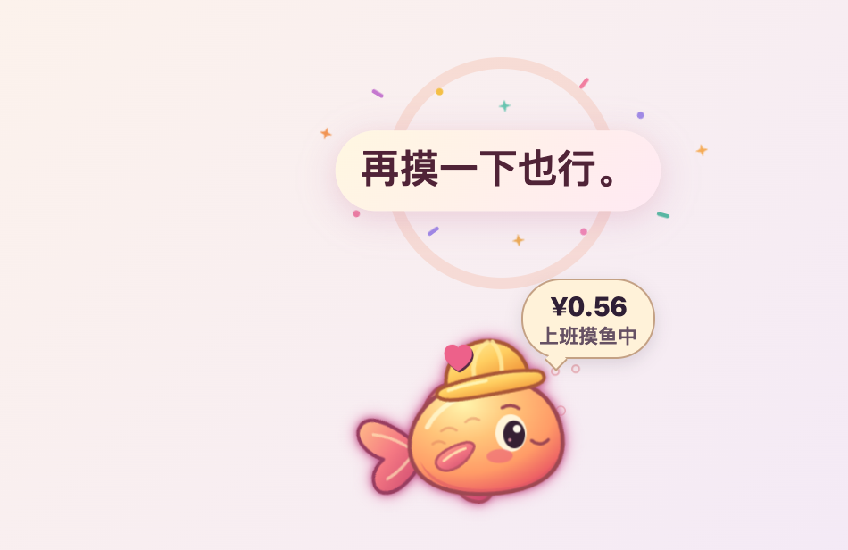
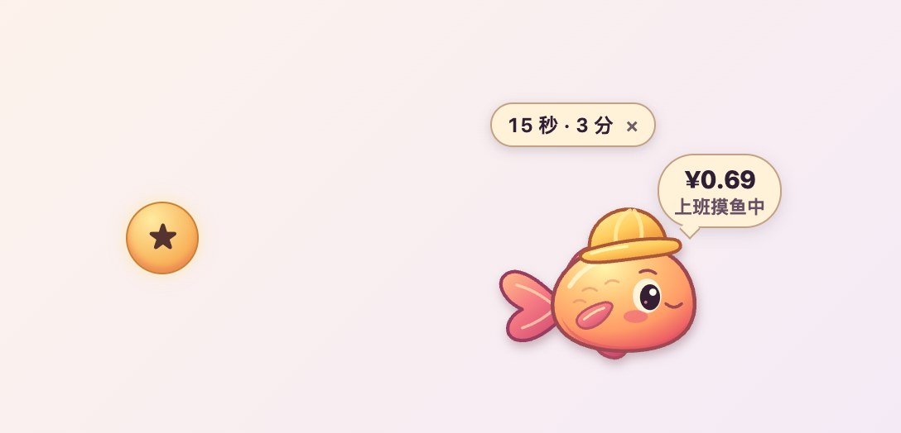

# 摸鱼发薪局

**等 AI 干活，点鱼放朵烟花。** 一条可以拖着游的 DSH 胖金鱼，随手摸一下、喂一颗，或者花 15 秒追泡泡。

- **左键点鱼**：颜色各异的星火炸开，台词放大定格。52 句摸鱼台词轮着说。
- **右键喂鱼**：看鱼粮飞到嘴边，听它换着说 12 句加餐吐槽。
- **右键戳泡泡**：泡泡直接浮在 DSH 工作台各处。普通泡泡 1 分，金泡泡 2 分，点鱼旁的计分提示可以提前结束。
- **拖鱼和计薪**：按住鱼拖动。点它吐出的工资泡泡打开班表，按工作时段估算工资，支持跳过午休及手动暂停。

## 安装

在 DeepSeek Harness 的插件页面添加此仓库。开源包名为 `dsh-fish-pay-counter`，原名「小鱼工资计数器」。已有安装可沿用本机班表和位置。

游戏开箱即玩。月薪默认留空，按中国标准时间和周一至周五估算，实际金额以工资单为准。班表、暂停记录和小鱼位置保存在当前工作台。插件无需账号、网络请求或模型调用。上图金额均为虚构。

在 macOS 的 DeepSeek Harness 0.2.2-rc.5 上验证。支持系统的减少动态效果设置。MIT License。

**English** — A draggable goldfish for your DSH workbench. Click the fish for one of 52 firework quips. Right-click to feed it or pop bubbles anywhere in the workbench during a 15-second round. The optional pay estimate uses your schedule and stays on your device.
