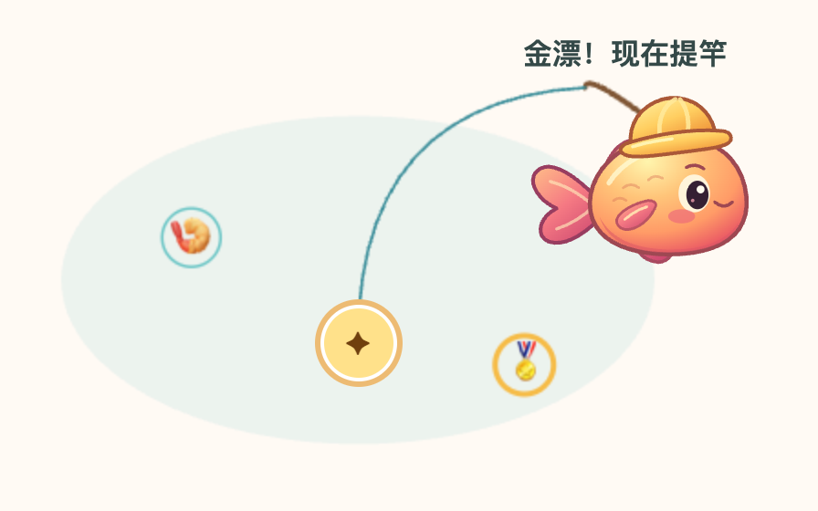

# Fish Pay Counter

Pet the workbench goldfish to see it squint and pop a firework quip. Cast a line, steer toward office oddities, and strike the gold float for a bonus catch. Includes bubble popping, outfits and an optional daily quip feed.

Right-click the fish and choose **小游戏 → 大肥鱼捞班味**. Click the fish to cast. Steer with the mouse or arrow keys as the hook returns. Wait for the float to flash gold and click it for a second item. You can also click the fish or press Space while it has focus. A hooked item comes home even if you miss the gold window.

Click its back for a stroke and a quip, or hold and drag to move. The games menu also has a 15-second bubble chase. To change outfits, subscribe to daily quips or configure your optional pay counter, open **装扮与设置**.

Both games work offline. Your salary and schedule stay on your device. Opting in to daily quips reads a public word list. Supports Reduce Motion and DSH `>=0.2.2-rc.3 <0.3.0`.
