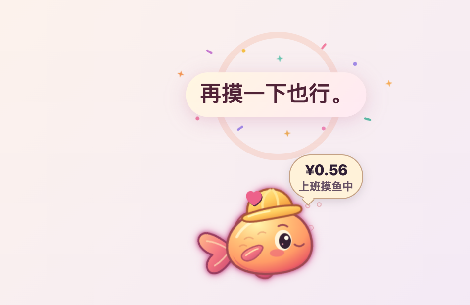
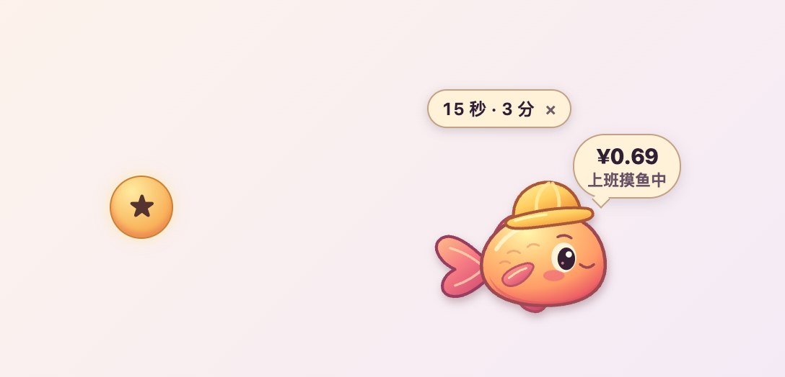

# 摸鱼发薪局

等 AI 干活的时候，桌上有条戴工帽的鱼替你数今天的工资。点它放朵烟花，喂它一颗鱼粮，或者花 15 秒追一局泡泡。

## 怎么玩

- **左键点鱼**：放一朵烟花，甩一句摸鱼台词，52 句轮换。
- **右键 → 投喂鱼粮**：鱼粮飞到嘴边，12 句加餐吐槽。
- **右键 → 戳泡泡**：泡泡浮在工作台各处，15 秒一局。普通泡泡 1 分，金泡泡 2 分。
- **按住拖动**：把鱼放到顺眼的地方，位置会记住。

## 数工资

点鱼下方的工资读数（或右键菜单里的「工资面板」），打开班表面板。填上月薪、每月计薪日和上下班时间，它按工作时段估算今天的工资。午休 12:00–13:00 的暂停默认开启，可以关掉；也能手动暂停计数。

金额按中国标准时间和周一至周五估算，图个乐，以工资单为准。

## 它不碰你的东西

月薪、班表和鱼的位置只保存在当前工作台的浏览器里。插件不需要账号，不发网络请求，不调模型。

支持系统的「减少动态效果」设置。
